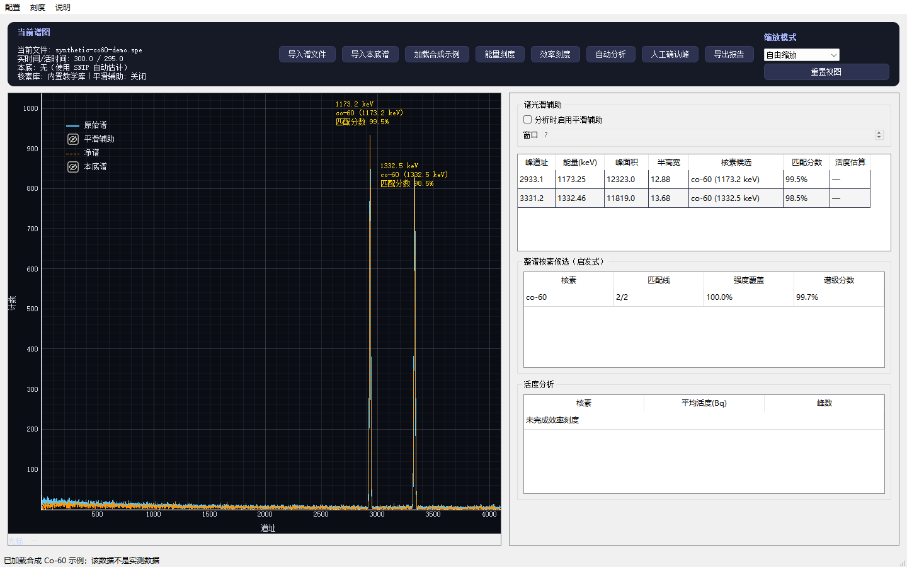

# 能谱分析工作台

一个面向核工程教学与课程项目展示的伽马能谱分析桌面原型。项目可读取常见谱文件，完成能谱可视化、本底扣除、峰识别、能量刻度、核素候选匹配和基于效率曲线的活度估算。

> 本项目是教学/科研原型，不是经计量检定或安全认证的软件。输出必须由具备相关知识的人员复核，不得直接用于安全、医疗、监管或环境合规决策。



## 项目亮点

- 支持 SPE、XLSX、CSV、TXT 文件，并对通道、计数和时间字段做基本校验。
- 支持两种本底处理：SNIP 自动估计连续本底，或导入**实测本底谱**按活时间比归一后逐道扣除，再在残差上做 SNIP。
- 使用 SNIP 算法估计连续本底，结合 Mexican-hat 连续小波变换寻找候选峰。
- 匹配容差按“绝对容差 / 相对容差 / 峰宽倍数”三者取最大，避免容差比探测器分辨率更窄。
- 内置库同时覆盖人工刻度源和天然放射性核素（U-238 系、Th-232 系、K-40）。
- 识别**不可分辨双线**（如 U-235 185.7 / Ra-226 186.2 keV）：标注全部成分与份额，不强行指定主核素、不算活度。
- 支持线性或二次能量刻度，并给出拟合均方根残差。
- 可通过手工刻度点或 JSON 刻度文件建立并复用线性/二次能量刻度。
- 可导入 JSON/CSV 核素参考库，并在界面中调整 SNIP、小波宽度、峰间距、信噪比和匹配容差。
- 同时提供单峰候选和整谱多谱线覆盖汇总；界面明确显示为“匹配分数”，不把启发式结果表述成统计置信度。
- 支持效率曲线拟合和活度估算，同时在报告中保留限制声明。
- 核心算法与桌面界面分离；命令行和自动化测试不依赖图形环境。
- 仓库只使用可公开的合成示例谱，不包含第三方实测数据或打包运行库。

## 快速体验

需要 Python 3.10 或更高版本。

```powershell
python -m venv .venv
.\.venv\Scripts\Activate.ps1
python -m pip install -e ".[gui]"
spectrum-analyzer
```

如果 Windows 上 Qt 在启动时长时间无响应，请将虚拟环境建在只含英文字符的路径中（例如 `C:\venvs\spectrum-analyzer`），再从该环境安装和运行项目。部分 PyQt5 运行库在含中文的虚拟环境路径中可能无法正常初始化；项目源码本身可以保留在中文路径。

打开程序后点击“加载合成示例”，即可看到两个模拟的 Co-60 光电峰。该示例由固定随机种子生成，并明确标记为合成数据。

想看实测本底扣除的效果：先导入 `examples\synthetic_sample_with_k40.spe`（Co-60 加一条模拟环境 K-40 线），再点“导入本底谱”选择 `examples\synthetic_lab_background.spe`。扣除后 1460.8 keV 的 K-40 峰消失，只剩 Co-60 两条线；灰色虚线是本底谱，橙色虚线是净谱。

只运行核心分析时，不需要安装 PyQt5：

```powershell
python -m pip install -e .
spectrum-analyzer-cli examples\synthetic_co60.spe --slope 0.4 --json result.json
```

使用自定义核素库和分析参数：

```powershell
spectrum-analyzer-cli examples\synthetic_co60.spe --slope 0.4 `
  --library examples\custom_library.csv --widths 2,4,6,8 `
  --min-snr 2.0 --absolute-tolerance 0.8 --json result.json
```

扣除实测本底谱（按活时间归一，也可用 `--background-scale real|none`）：

```powershell
spectrum-analyzer-cli sample.spe --slope 0.137145 --offset 0.0133 `
  --background background.spe --json result.json
```

输出中的 `unresolved_doublet` 字段会列出不可分辨双线的各成分及份额；`background` 字段记录本底文件、归一系数、重采样和截断通道数。

## 运行测试

```powershell
python -m pip install -e ".[gui,dev]"
python -m unittest discover -s tests -v
```

测试覆盖 SPE 时间与两种通道范围写法、CSV 导入、自定义核素库、能量刻度拟合、可配置合成谱分析、整谱核素汇总、非法负计数拦截和 GUI 冒烟测试。GitHub Actions 会在每次推送和合并请求时自动运行完整测试；未安装 GUI 依赖时，界面测试会自动跳过。

## 处理流程

1. 解析并校验谱文件，保留实时间和活时间等元数据。
2. 如导入实测本底谱，按时间比归一后逐道扣除；否则跳过。
3. 通过 SNIP 估计连续本底，得到非负净计数谱。
4. 对多个尺度执行连续小波变换，筛选具有足够信噪比的候选峰。
5. 在局部窗口计算峰位、面积和半高宽。
6. 使用用户能量刻度把通道转换为能量，并与当前导入的参考库匹配；同峰内出现多条不同核素参考线时标记为双线。
7. 按参考线覆盖程度生成整谱核素候选汇总，帮助人工处理共享能量线和混合谱。
8. 如已输入探测器效率刻度，则按峰面积、活时间、效率和发射概率估算活度。

更详细的假设见 [算法说明](docs/ALGORITHMS.md)，适用边界见 [科学限制](docs/SCIENTIFIC_LIMITATIONS.md)。

## 数据与目录

```text
examples/                    合成示例谱与可复现输出
src/spectrum_analyzer/       核心算法、桌面界面和命令行入口
tests/                       不依赖 GUI 的单元测试
docs/                        算法、限制和数据政策
```

用户生成的效率模型和报告默认写入 `%USERPROFILE%\.spectrum-analyzer`，不会写回仓库。数据收录原则见 [数据政策](docs/DATA_POLICY.md)。

## 核数据说明

内置参考库只覆盖少量教学常见核素，不能代替完整核数据库。参考能量和发射概率应在真实分析前通过美国布鲁克海文国家实验室 NNDC 的 [NuDat 3](https://www.nndc.bnl.gov/nudat3/) 复核；NuDat 的结构与衰变数据来自 ENSDF。

## 当前状态与路线图

当前版本为 `v0.4.0`。本地回归已覆盖四份 16384 道比赛 SPE 样本；这些原始样本仅用于兼容性验证，未收入仓库。后续适合继续完善的方向包括：

- 从经授权的数据文件加载完整、可追溯版本的核素库；
- 引入峰拟合不确定度和活度不确定度传播（含扣底截断偏差）；
- 增加双线成分的定量分解（固定能量间距的约束拟合）；
- 增加衰变校正、几何修正、自吸收和符合相加修正；
- 使用带证书的标准源和真实探测器数据进行验证；
- 增加更多仪器文件格式及端到端界面测试。

## 作者与权利

罗俊仁，核工程与核技术专业本科生。项目源于个人能谱分析软件实践，后整理为可测试、可公开展示的作品集版本。

本项目采用 [Apache License 2.0](LICENSE) 开源许可证。
